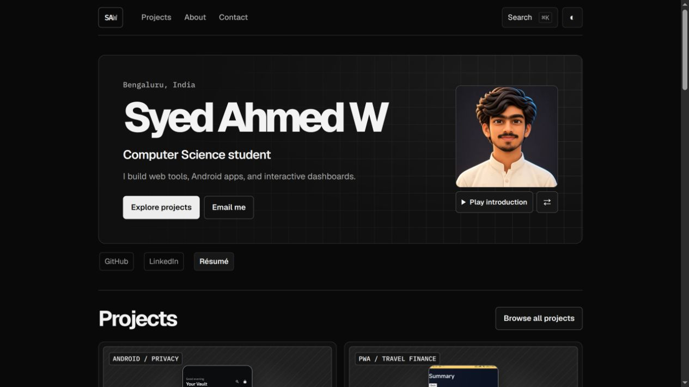
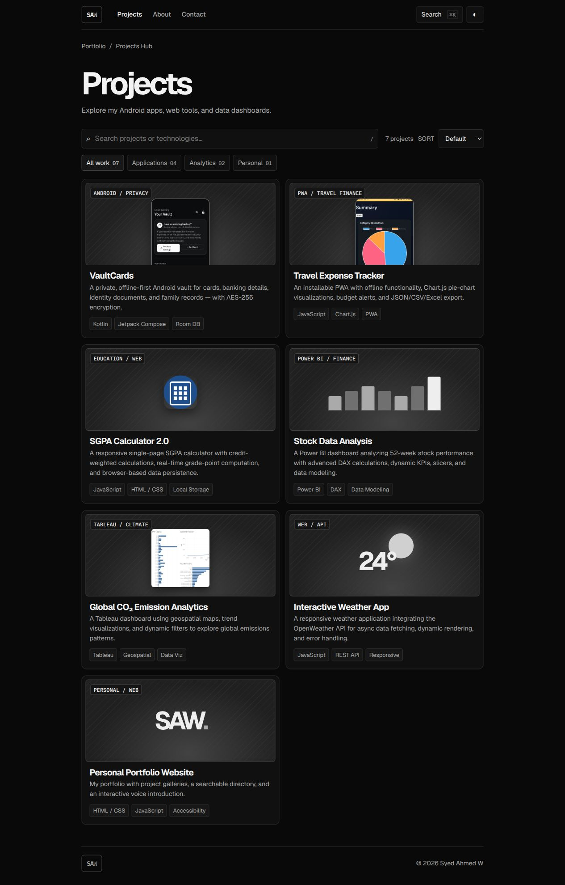
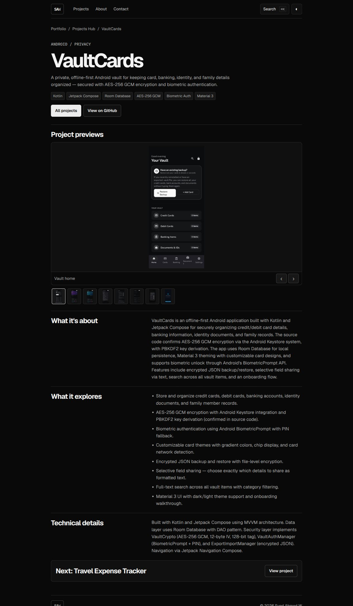

# Syed Ahmed W | Portfolio

My personal portfolio covers web development, Android apps, and data analytics. It includes seven projects, screenshot galleries, an animated avatar with my recorded introduction, and a downloadable resume.

## Screenshots

### Homepage



### Project directory



### Project detail



## Local preview

Run this from the repository root, then open [localhost:8000](http://localhost:8000).

```sh
python3 -m http.server 8000
```

You can also open `index.html` directly. The site uses HTML, CSS, and JavaScript with no build step.

## Publish with GitHub Pages

1. Commit the contents of this folder to the root of your GitHub repository. Include `.nojekyll` and keep `index.html` at the repository root.
2. Open **Settings → Pages**. Set **Source** to **Deploy from a branch**.
3. Select your publishing branch, usually `main`, and **/ (root)**. Click **Save**.
4. Open the site URL shown under **Settings → Pages** after deployment completes.

[GitHub Pages publishing documentation](https://docs.github.com/en/pages/getting-started-with-github-pages/configuring-a-publishing-source-for-your-github-pages-site)

## Site files

- `index.html` contains the homepage and featured projects.
- `projects.html` contains the searchable project directory. `project.html` displays individual projects from the data in `app.js`.
- `resume.html` displays the résumé preview and links to `assets/resume.pdf`.
- `assets/` holds the artwork, project screenshots, résumé, and avatar recording.
